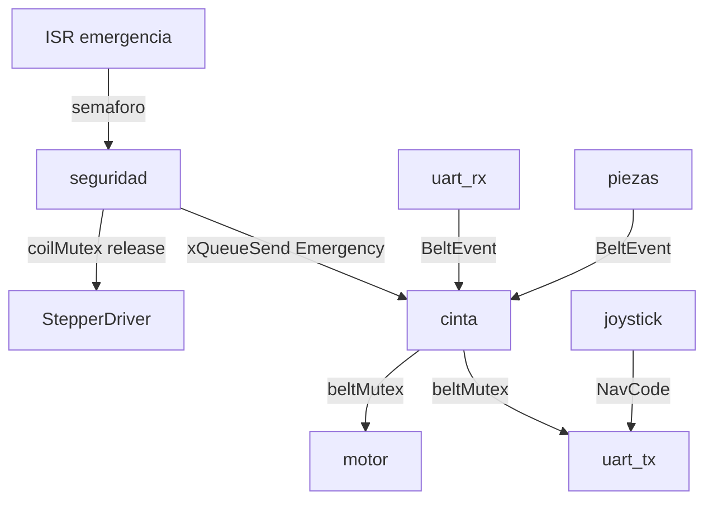

# Dónde va cada mecanismo de FreeRTOS

Las tasks están en [esp32/main/app_main.cpp](../esp32/main/app_main.cpp). FreeRTOS se llama directo, sin envolverlo en una clase. Se crean juntas y cada una lleva un comentario de por qué esa prioridad. El stack está en bytes.

La máquina de estados sigue siendo `apply`, en [esp32/main/domain/belt.cpp](../esp32/main/domain/belt.cpp). Una sola task la llama. El resto produce eventos o mira el resultado. Los drivers están en [drivers.md](drivers.md). Los números del cable están en [protocolo.md](protocolo.md).

## Qué mecanismo usar

- Task periódica, con `vTaskDelayUntil`, cuando el período importa. Si se atrasa, el trabajo sale tarde: el motor pierde pasos, el joystick lee fuera de tiempo.
- Task que espera, cuando no hay nada que hacer hasta que llegue un aviso o una línea. No gasta el procesador dando vueltas.
- Cola, cuando una task le pasa un dato a otra. El dato es un `BeltEvent` o un `NavCode`.
- Semáforo binario, cuando una interrupción solo avisa y no hay dato que pasar. La ISR no llama a `apply`, no frena el motor y no escribe en el log. Usa la función `FromISR`.
- Mutex del `Belt`, cuando varias tasks necesitan el último estado. No es una cola: importa el valor vigente, no el historial de cambios. `Take` y `Give` van en la misma función.
- `coilMutex`, aparte. El motor y la seguridad escriben los mismos cuatro GPIO del stepper. Sin él, una emergencia a mitad de `step()` podía volver a energizar las bobinas. No se toma junto con el mutex del `Belt`: se copia el estado, se suelta, y recién ahí se tocan las bobinas.

`vTaskDelay` no sirve para esperar a que otra task termine. Para eso está la cola o el semáforo.

## Mapa de la cinta

La urgencia fija la prioridad: seguridad 5, cinta 4, motor 3, entradas 2, uart_tx y latido 1. Van todas al núcleo 1. En dos núcleos esa prioridad no ordena al motor respecto de seguridad, y `step()` podría pisar el `release()`.

### Seguridad, prioridad 5

La interrupción del pulsador de emergencia suelta un semáforo. No hay payload: el hecho ya es "se apretó". La task de seguridad lo toma y suelta las bobinas en ese momento, bajo `coilMutex`. Esperar a que la cola de eventos avance perdería tiempo con el motor todavía energizado. Después encola `Emergency` al final de la cola, para que el estado lo cambie la task de la cinta. Adelantarlo dejaría un `Start` ya encolado para después, y ese arranque saldría de emergencia. El corte de las bobinas no depende de la cola: `cinta` tiene prioridad 4 y la vacía enseguida.

### Cinta, prioridad 4

Es la única que llama a `apply`. Espera la cola de `BeltEvent` (comandos de la UART, piezas, emergencia). Guarda el `Belt` resultante bajo el mutex. No toca pines. Queda encima del motor para que el estado ya esté escrito antes del próximo paso.

### Motor, prioridad 3

Periódica. El período sale de la velocidad: cerca de 8, 4 o 2 ms entre medios pasos. Por eso el tick de FreeRTOS está en 1000 Hz. Lee el `Belt` bajo su mutex, lo suelta, y recién ahí toma `coilMutex`. Si el estado es marcha, llama a `step`. Si no, llama a `release` y no da pasos. El driver no espera: la espera es el período de esta task. También prende el LED verde en marcha y el rojo en emergencia.

Si la emergencia sigue accionada, o ya lo está al encender, ARRANCAR vuelve a marcha igual. El enclavamiento con el pulsador quedó fuera del prototipo.

### Joystick, piezas y uart_rx, prioridad 2

Las tres son entradas. Comparten prioridad porque ninguna tiene que ganarle a la otra: las tres pueden esperar 20 ms.

- Joystick, periódica cada 20 ms. Lee `readRaw` y el botón OK. Compara el eje con umbrales y, si hay un flanco de navegación, encola un `NavCode`. El driver no decide arriba ni abajo. Los umbrales son fijos. La histéresis, por si el ruido del ADC repite la navegación, quedó fuera del prototipo.
- Piezas, periódica. Hace el antirrebote del pulsador y, por cada pulsación válida, encola `Piece`. El driver solo dice si el pin está en bajo.
- `uart_rx`, espera una línea. `readLine` bloquea hasta el `\n`. Si `interpret` reconoce una acción, encola ese `BeltEvent`. Una línea de log, o un `$1` que volvió por error, no entra a la cola.

Si la cola está llena, `piezas`, `uart_rx` y el joystick avisan con `ESP_LOGW` y ese evento se pierde.

### uart_tx y latido, prioridad 1

`uart_tx` es la única que escribe el UART. Así el joystick y la cinta no se pisan en el cable. Lee el `Belt` bajo el mutex y manda `$1,...` cada 100 ms. Cuando hay un `NavCode` en su cola, manda `$2,...` sin esperar al próximo estado.

`latido` conmuta el LED azul cada 400 ms. Comparte la prioridad 1 porque las dos pueden esperar: ninguna corta el motor.

## Qué no va acá

- La máquina de estados no va dentro de un driver ni dentro de la ISR.
- El antirrebote no va en `Button`. Los umbrales del joystick no van en `JoystickAxis`. Los números `$3,1` no van en `UartLink`.
- No se envuelve `xQueueCreate` ni el mutex en una clase propia.
- El enclavamiento de la emergencia y la histéresis del joystick no están en este prototipo.
