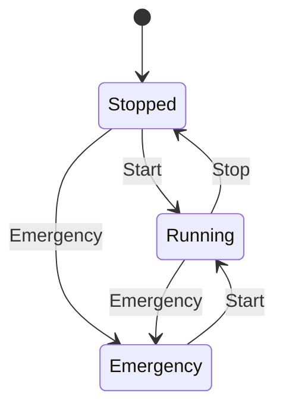

# Máquina de estados de la cinta

La cinta se decide en una función, `apply`, en [esp32/main/domain/belt.hpp](../esp32/main/domain/belt.hpp) y [esp32/main/domain/belt.cpp](../esp32/main/domain/belt.cpp). Recibe la cinta y un evento, y devuelve la cinta siguiente. No lee pines, no crea tasks y no guarda nada global: por eso se puede probar en la PC antes de tener la ESP32.

Queda afuera de este módulo el motor, los pulsadores, la UART y FreeRTOS. Esas partes van a producir eventos (`Start`, `Emergency`, `Piece`, …) y a mirar el resultado. Si el estado no es `Running`, quien mueva el motor no da pasos.

## Nombres

| En el código | En la consigna |
|---|---|
| `Stopped` | PARADA |
| `Running` | MARCHA |
| `Emergency` | EMERGENCIA |
| `Low` | BAJA |
| `Medium` | MEDIA |
| `High` | ALTA |

Al crear un `Belt` queda parada, en velocidad baja y con cero piezas. Así la placa no arranca en marcha al alimentarse.

## Estados

Estos eventos dejan el estado como está:

- `Stop` en `Stopped`: ya está parada.
- `Start` en `Running`: ya está en marcha.
- `Stop` en `Emergency`: PARAR no suelta la emergencia. Si lo hiciera, el menú saldría de emergencia sin un arranque explícito.
- `Emergency` en `Emergency`: el pulsador puede repetirse; sigue en emergencia.

De emergencia se sale solo con `Start`, y ese arranque la pasa a marcha, porque el botón del menú es ARRANCAR.

## Velocidad y piezas

No son estados. El menú puede cambiarlos con la cinta parada, en marcha o en emergencia, y el estado no se mueve.

| Evento | Efecto |
|---|---|
| `SetLow`, `SetMedium`, `SetHigh` | Pasa a esa velocidad |
| `Piece` | Suma una pieza, también parada o en emergencia: el pulsador cuenta cada pulsación |
| `ResetPieces` | Deja la cuenta en cero |

## Dónde se ve

`apply` está en [esp32/main/domain/belt.cpp](../esp32/main/domain/belt.cpp). La task `cinta` es la única que la llama. El diagrama de arriba es el de esa función.
